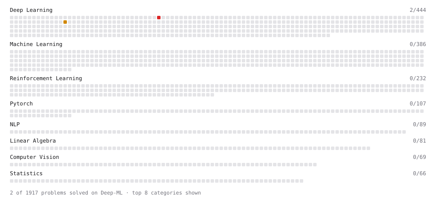

# Deep-ML

My machine learning practice from [Deep-ML](https://www.deep-ml.com). Every solution here was written by hand.

**2** solved · 2 problems · 0 labs · 0 math

[**Browse the interactive portfolio**](https://Athe-kunal.github.io/deep-ml/) to replay this filling in over time.

## Problems

| | Difficulty | Solved | |
| --- | --- | --- | --- |
| [Mixture of Experts Load Balancing Loss](https://www.deep-ml.com/problems/389) | medium | 2026-11-06 | [solution](problems/0389-mixture-of-experts-load-balancing-loss) |
| [Implement a Sparse Mixture of Experts Layer](https://www.deep-ml.com/problems/125) | hard | 2026-11-06 | [solution](problems/0125-implement-a-sparse-mixture-of-experts-layer) |

---

_This file is regenerated by Deep-ML on every push._
